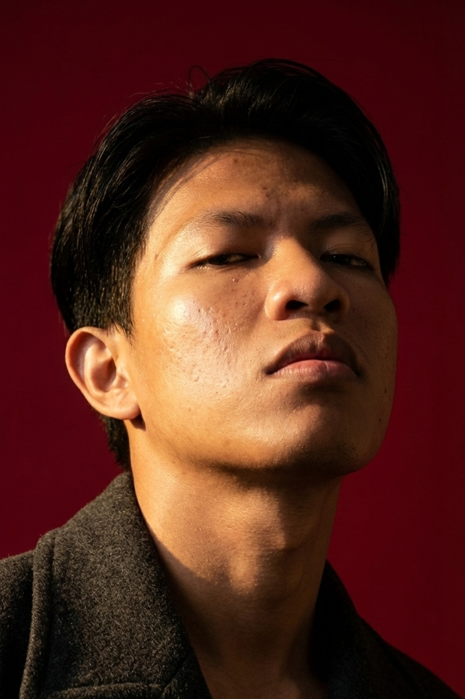

# **TUGAS 2 - Web Profile / CV dengan External CSS** 

Nama : Ariestia Saputra NIM : 25416255201066 Kelas : IF25F 

## **1. Struktur File** 

```
tugas2/
```

```
├── 25416255201066_Ariestia_Saputra.html  (halaman utama: Web Profile / CV)
```

```
├── portofolio.html                       (halaman tambahan: proyek & pengalaman kerja)
├── style.css                             (external CSS)
└── foto_profil.png                       (foto profil)
```

## **2. Ringkasan Pemenuhan Ketentuan** 

|**No**|**Ketentuan**|**Penerapan**|
|---|---|---|
|3|Hubungkan style.css|<link rel="stylesheet" href="style.css"> pada <head> kedua<br>halaman|
|4|Atur judul, paragraf, info diri, foto,<br>tabel, link sosmed|Selector h1, .justify, .info, .photo img, .tabel-pendidikan, .social a|
|5|Gunakan <div>|div.container, .header, .nav, .section, .profile-box, .skills, .card,<br>.footer|
|6|Gunakan <span>|span.label, span.highlight, span.judul-proyek, span.tag|
|7|Link relatif|href="portofolio.html" dan<br>href="25416255201066_Ariestia_Saputra.html" (saling terhubung)|
|8|Link absolut|GitHub, LinkedIn, dan Instagram (https://...)|
|9|Uji link|Link relatif dan foto diperiksa: semua file ada. GitHub merespons<br>200|


Tugas 2 - Web Profile / CV  |  Ariestia Saputra  |  NIM 25416255201066  |  IF25F 

Halaman 1 

**3. Kode Program: 25416255201066_Ariestia_Saputra.html** 

```
  1  <!DOCTYPE html>
  2  <html lang="id">
  3  <head>
  4      <meta charset="UTF-8">
  5      <meta name="viewport" content="width=device-width, initial-scale=1.0">
  6      <title>Web Profile / CV - Ariestia Saputra</title>
  7      <!-- Menghubungkan external CSS -->
  8      <link rel="stylesheet" href="style.css">
  9  </head>
 10  <body>
 11
 12      <div class="container">
 13
 14          <!-- Judul halaman -->
 15          <div class="header">
 16              <h1>Curriculum Vitae</h1>
 17              <p class="tagline">Selamat Datang di Halaman Profil Web Saya!</p>
 18          </div>
 19
 20          <!-- Navigasi: link relatif ke halaman lain dalam folder yang sama -->
 21          <div class="nav">
 22              <a href="25416255201066_Ariestia_Saputra.html" class="active">Profil</a>
 23              <a href="portofolio.html">Detail Proyek</a>
 24          </div>
 25
 26          <!-- Foto & informasi pribadi -->
 27          <div class="section profile-box">
 28              <div class="photo">
 29                  
 30              </div>
 31              <div class="info">
 32                  <h2>Informasi Pribadi</h2>
 33                  <ul>
 34                      <li><span class="label">NIM</span> 25416255201066</li>
 35                      <li><span class="label">Nama</span> Ariestia Saputra</li>
 36                      <li><span class="label">Kelas</span> IF25F</li>
 37                      <li><span class="label">Email</span> <a
                           href="mailto:ariestiasaputra@gmail.com">ariestiasaputra@gmail.com</a></li>
 38                      <li><span class="label">No. HP</span> 083814324925</li>
 39                  </ul>
 40              </div>
 41          </div>
 42
 43          <!-- Profil singkat -->
 44          <div class="section">
 45              <h2>Profil Singkat</h2>
 46              <p class="justify">
 47                  Halo! Saya adalah mahasiswa S1 program studi
 48                  <span class="highlight">Teknik Informatika Universitas Buana Perjuangan
                       Karawang</span>.
 49                  Saat ini saya telah menyelesaikan <span class="highlight">39 SKS</span>
 50                  dengan <span class="highlight">IPK 3.59</span> dan memiliki target untuk lulus
                       dengan predikat
 51                  <em>cum laude</em>. Saya memiliki minat yang besar dalam pengembangan perangkat
                       lunak
 52                  (terutama <em>Object-Oriented Programming</em>), eksplorasi teknologi baru, serta
                       perakitan
 53                  dan pemeliharaan perangkat keras.
 54              </p>
 55          </div>
 56
 57          <!-- Riwayat pendidikan (tabel) -->
 58          <div class="section">
 59              <h2>Riwayat Pendidikan</h2>
 60              <table class="tabel-pendidikan">
 61                  <tr>
 62                      <th>Pendidikan</th>
 63                      <th>Jurusan</th>
 64                      <th>Tahun</th>
 65                  </tr>
 66                  <tr>
 67                      <td>SMK Negeri 1 Karawang</td>
 68                      <td>Teknik Elektronika Industri</td>
 69                      <td>2021 - 2024</td>
 70                  </tr>
 71                  <tr>
 72                      <td>Universitas Buana Perjuangan Karawang</td>
 73                      <td>Teknik Informatika</td>
 74                      <td>2025 - Sekarang</td>
 75                  </tr>
 76              </table>
```

Tugas 2 - Web Profile / CV  |  Ariestia Saputra  |  NIM 25416255201066  |  IF25F 

Halaman 2 

```
 77          </div>
 78
 79          <!-- Keterampilan IT -->
 80          <div class="section">
 81              <h2>Keterampilan IT</h2>
 82              <div class="skills">
 83                  <div class="skill-col">
 84                      <ul>
 85                          <li><b>Bahasa Pemrograman:</b> Python, Java</li>
 86                          <li><b>Sistem Operasi:</b> Windows, Linux Mint</li>
 87                      </ul>
 88                  </div>
 89                  <div class="skill-col">
 90                      <ul>
 91                          <li><b>Tools &amp; Lingkungan:</b> Git, GitHub, VS Code</li>
 92                          <li><b>Hardware:</b> Repurposing baterai 18650, upgrade RAM/SSD NVMe</li>
 93                      </ul>
 94                  </div>
 95              </div>
 96          </div>
 97
 98          <!-- Pengalaman proyek -->
 99          <div class="section">
100              <h2>Pengalaman Proyek</h2>
101              <ol>
102                  <li><span class="judul-proyek">Aplikasi Manajemen Member Fitness:</span> Membangun
                        aplikasi berbasis <em>Command Line Interface</em> (CLI) menggunakan Python
                       dengan penyimpanan data berstruktur dan <em>logging</em> CSV.</li>
103                  <li><span class="judul-proyek">Simulasi Sistem Pencahayaan Smart Home:</span>
                       Memodelkan <em>Deterministic Finite Automata</em> (DFA) menggunakan sirkuit
                       Redstone di Minecraft.</li>
104                  <li><span class="judul-proyek">Self-Hosted Home Server:</span> Mengelola server
                       lokal menggunakan Linux Mint, menjalankan layanan seperti Nextcloud dan
                       Portainer via kontainer Docker.</li>
105              </ol>
106              <!-- Link relatif ke halaman kedua -->
107              <p class="link-lanjut"><a href="portofolio.html">Lihat detail proyek &rarr;</a></p>
108          </div>
109
110          <!-- Media sosial: link absolut ke website eksternal -->
111          <div class="section">
112              <h2>Media Sosial &amp; Tautan</h2>
113              <div class="social">
114                  <a href="https://github.com/ariestiasaputra" target="_blank"
                       rel="noopener">GitHub</a>
115                  <a href="https://www.linkedin.com/in/ariestia-saputra/" target="_blank"
                       rel="noopener">LinkedIn</a>
116                  <a href="https://www.instagram.com/ariestia.sptra" target="_blank"
                       rel="noopener">Instagram</a>
117              </div>
118          </div>
119
120          <div class="footer">
121              &copy; 2026 Ariestia Saputra - IF25F
122          </div>
123
124      </div>
125
126  </body>
127  </html>
128
```

Tugas 2 - Web Profile / CV  |  Ariestia Saputra  |  NIM 25416255201066  |  IF25F 

Halaman 3 

## **4. Kode Program: style.css** 

```
  1  /* ==========================================================
  2     style.css - External CSS untuk Web Profile / CV
  3     Dihubungkan lewat: <link rel="stylesheet" href="style.css">
  4     ========================================================== */
  5
  6  * {
  7      -webkit-box-sizing: border-box;
  8      box-sizing: border-box;
  9  }
 10
 11  body {
 12      margin: 0;
 13      padding: 20px 0;
 14      background-color: #f4f6f9;
 15      color: #333333;
 16      font-family: Arial, Helvetica, sans-serif;
 17      font-size: 15px;
 18      line-height: 1.6;
 19  }
 20
 21  /* ---------- Pembungkus utama ---------- */
 22  .container {
 23      width: 80%;
 24      max-width: 900px;
 25      margin: 0 auto;
 26  }
 27
 28  /* ---------- Judul / header ---------- */
 29  .header {
 30      text-align: center;
 31      padding: 10px 0 15px;
 32      border-bottom: 4px solid #2369EB;
 33      margin-bottom: 15px;
 34  }
 35
 36  .header h1 {
 37      margin: 0;
 38      font-size: 34px;
 39      letter-spacing: 1px;
 40      color: #1a4fb8;
 41  }
 42
 43  .tagline {
 44      margin: 6px 0 0;
 45      font-style: italic;
 46      color: #555555;
 47  }
 48
 49  /* ---------- Navigasi ---------- */
 50  .nav {
 51      text-align: center;
 52      margin-bottom: 20px;
 53  }
 54
 55  .nav a {
 56      display: inline-block;
 57      margin: 0 4px;
 58      padding: 7px 18px;
 59      background-color: #ffffff;
 60      color: #2369EB;
 61      border: 1px solid #2369EB;
 62      border-radius: 4px;
 63      font-weight: bold;
 64      text-decoration: none;
 65  }
 66
 67  .nav a:hover,
 68  .nav a.active {
 69      background-color: #2369EB;
 70      color: #ffffff;
 71  }
 72
 73  /* ---------- Kotak bagian (section) ---------- */
 74  .section {
 75      margin-bottom: 20px;
 76      padding: 20px 25px;
 77      background-color: #ffffff;
 78      border: 1px solid #e3e8ef;
 79      border-radius: 6px;
 80  }
 81
```

Tugas 2 - Web Profile / CV  |  Ariestia Saputra  |  NIM 25416255201066  |  IF25F 

Halaman 4 

```
 82  .section h2 {
 83      margin: 0 0 12px;
 84      padding-left: 10px;
 85      border-left: 5px solid #2369EB;
 86      font-size: 20px;
 87      color: #1a4fb8;
 88  }
 89
 90  /* ---------- Foto + informasi pribadi ---------- */
 91  .profile-box {
 92      overflow: hidden;
 93  }
 94
 95  .photo {
 96      float: left;
 97      width: 170px;
 98      text-align: center;
 99  }
100
101  .photo img {
102      width: 150px;
103      height: auto;
104      border: 3px solid #2369EB;
105      border-radius: 4px;
106  }
107
108  .info {
109      margin-left: 190px;
110  }
111
112  .info ul {
113      margin: 0;
114      padding: 0;
115      list-style: none;
116  }
117
118  .info li {
119      padding: 4px 0;
120      border-bottom: 1px dotted #cccccc;
121  }
122
123  /* ---------- Teks yang diberi style dengan <span> ---------- */
124  .label {
125      display: inline-block;
126      width: 75px;
127      font-weight: bold;
128      color: #1a4fb8;
129  }
130
131  .highlight {
132      padding: 0 3px;
133      background-color: #fff3b0;
134      font-weight: bold;
135  }
136
137  .tag {
138      display: inline-block;
139      margin-right: 5px;
140      padding: 2px 10px;
141      background-color: #e4edff;
142      color: #1a4fb8;
143      border-radius: 10px;
144      font-size: 13px;
145  }
146
147  .judul-proyek {
148      font-weight: bold;
149      color: #1a4fb8;
150  }
151
152  /* ---------- Paragraf ---------- */
153  .justify {
154      margin: 0;
155      text-align: justify;
156  }
157
158  /* ---------- Tabel pendidikan & pengalaman kerja ---------- */
159  .tabel-pendidikan,
160  .tabel-pengalaman {
161      width: 100%;
162      border-collapse: collapse;
163  }
164
165  .tabel-pendidikan th,
```

Tugas 2 - Web Profile / CV  |  Ariestia Saputra  |  NIM 25416255201066  |  IF25F 

Halaman 5 

```
166  .tabel-pengalaman th {
167      padding: 10px;
168      background-color: #2369EB;
169      color: #ffffff;
170      border: 1px solid #0056D1;
171  }
172
173  .tabel-pendidikan td,
174  .tabel-pengalaman td {
175      padding: 10px;
176      border: 1px solid #0056D1;
177      text-align: center;
178  }
179
180  .tabel-pendidikan tr:nth-child(odd) td,
181  .tabel-pengalaman tr:nth-child(odd) td {
182      background-color: #f9f9f9;
183  }
184
185  .tabel-pendidikan tr:nth-child(even) td,
186  .tabel-pengalaman tr:nth-child(even) td {
187      background-color: #f0f6ff;
188  }
189
190  .tabel-pengalaman td:last-child {
191      text-align: left;
192  }
193
194  /* ---------- Keterampilan (dua kolom) ---------- */
195  .skills {
196      overflow: hidden;
197  }
198
199  .skill-col {
200      float: left;
201      width: 49%;
202      padding: 10px 15px;
203      background-color: #f9f9f9;
204  }
205
206  .skill-col + .skill-col {
207      margin-left: 2%;
208  }
209
210  .skill-col ul {
211      margin: 0;
212      padding-left: 18px;
213  }
214
215  /* ---------- Kartu proyek (halaman portofolio.html) ---------- */
216  .card {
217      margin-bottom: 15px;
218      padding: 12px 18px;
219      background-color: #f9fbff;
220      border: 1px solid #d6e2fb;
221      border-left: 5px solid #2369EB;
222  }
223
224  .card h3 {
225      margin: 0 0 6px;
226      color: #1a4fb8;
227  }
228
229  .card p {
230      margin: 0 0 8px;
231  }
232
233  /* ---------- Link media sosial ---------- */
234  .social {
235      text-align: center;
236  }
237
238  .social a,
239  .btn {
240      display: inline-block;
241      margin: 4px;
242      padding: 8px 20px;
243      background-color: #2369EB;
244      color: #ffffff;
245      border-radius: 4px;
246      font-weight: bold;
247      text-decoration: none;
248  }
249
```

Tugas 2 - Web Profile / CV  |  Ariestia Saputra  |  NIM 25416255201066  |  IF25F 

Halaman 6 

```
250  .social a:hover,
251  .btn:hover {
252      background-color: #0056D1;
253  }
254
255  a {
256      color: #2369EB;
257  }
258
259  .link-lanjut {
260      margin: 12px 0 0;
261  }
262
263  /* ---------- Footer ---------- */
264  .footer {
265      padding: 10px 0;
266      text-align: center;
267      font-size: 13px;
268      color: #777777;
269  }
270
271  /* ---------- Tampilan layar kecil ---------- */
272  @media (max-width: 600px) {
273      .container { width: 94%; }
274      .photo { float: none; width: 100%; margin-bottom: 15px; }
275      .info { margin-left: 0; }
276      .skill-col { float: none; width: 100%; }
277      .skill-col + .skill-col { margin-left: 0; margin-top: 10px; }
278  }
279
```

Tugas 2 - Web Profile / CV  |  Ariestia Saputra  |  NIM 25416255201066  |  IF25F 

Halaman 7 

## **5. Kode Program: portofolio.html** 

```
  1  <!DOCTYPE html>
  2  <html lang="id">
  3  <head>
  4      <meta charset="UTF-8">
  5      <meta name="viewport" content="width=device-width, initial-scale=1.0">
  6      <title>Portofolio - Ariestia Saputra</title>
  7      <link rel="stylesheet" href="style.css">
  8  </head>
  9  <body>
 10
 11      <div class="container">
 12
 13          <div class="header">
 14              <h1>Portofolio saya</h1>
 15              <p class="tagline">Pengalaman Kerja dan Proyek-proyek yang pernah saya kerjakan</p>
 16          </div>
 17
 18          <!-- Navigasi: link relatif kembali ke halaman utama -->
 19          <div class="nav">
 20              <a href="25416255201066_Ariestia_Saputra.html">Profil</a>
 21              <a href="portofolio.html" class="active">Detail Proyek</a>
 22          </div>
 23
 24          <!-- Pengalaman kerja -->
 25          <div class="section">
 26              <h2>Pengalaman Kerja</h2>
 27              <table class="tabel-pengalaman">
 28                  <tr>
 29                      <th>Posisi</th>
 30                      <th>Perusahaan / Instansi</th>
 31                      <th>Periode</th>
 32                      <th>Deskripsi</th>
 33                  </tr>
 34                  <tr>
 35                      <td>Support Admin</td>
 36                      <td>PT Autoplastik Indonesia</td>
 37                      <td>Oktober 2023 -April 2024</td>
 38                      <td>Melakukan kegiatan administrasi dibagian <i>Quality Proses</i> (PKL).</td>
 39                  </tr>
 40                                  <tr>
 41                      <td>Operator Produksi</td>
 42                      <td>PT Baiksan Indonesia</td>
 43                      <td>Juli 2025 - Sekarang</td>
 44                      <td>Melakukan produksi bahan baku yang diperlukan untuk mesin produksi sesuai
                           SOP yang ada.</td>
 45                  </tr>
 46              </table>
 47          </div>
 48
 49          <div class="section">
 50              <h2>Daftar Proyek</h2>
 51
 52              <div class="card">
 53                  <h3>1. Aplikasi Manajemen Member Fitness</h3>
 54                  <p>Aplikasi berbasis <em>Command Line Interface</em> (CLI) dengan penyimpanan data
                        berstruktur dan <em>logging</em> CSV.</p>
 55                  <span class="tag">Python</span>
 56                  <span class="tag">CLI</span>
 57                  <span class="tag">CSV</span>
 58              </div>
 59
 60              <div class="card">
 61                  <h3>2. Simulasi Sistem Pencahayaan Smart Home</h3>
 62                  <p>Pemodelan <em>Deterministic Finite Automata</em> (DFA) menggunakan sirkuit
                       Redstone di Minecraft.</p>
 63                  <span class="tag">DFA</span>
 64                  <span class="tag">Redstone</span>
 65                  <span class="tag">Minecraft</span>
 66              </div>
 67
 68              <div class="card">
 69                  <h3>3. Self-Hosted Home Server</h3>
 70                  <p>Pengelolaan server lokal dengan Linux Mint, menjalankan layanan seperti
                       Nextcloud dan Portainer melalui kontainer Docker.</p>
 71                  <span class="tag">Linux Mint</span>
 72                  <span class="tag">Docker</span>
 73                  <span class="tag">Nextcloud</span>
 74                  <span class="tag">Portainer</span>
 75              </div>
 76          </div>
 77
```

Tugas 2 - Web Profile / CV  |  Ariestia Saputra  |  NIM 25416255201066  |  IF25F 

Halaman 8 

```
 78          <div class="section">
 79              <h2>Tautan</h2>
 80              <div class="social">
 81                  <!-- Link absolut ke website eksternal -->
 82                  <a href="https://github.com/ariestiasaputra" target="_blank" rel="noopener">Lihat
                       Repositori di GitHub</a>
 83                  <!-- Link relatif kembali ke halaman utama -->
 84                  <a href="25416255201066_Ariestia_Saputra.html">&larr; Kembali ke Profil</a>
 85              </div>
 86          </div>
 87
 88          <div class="footer">
 89              &copy; 2026 Ariestia Saputra - IF25F
 90          </div>
 91
 92      </div>
 93
 94  </body>
 95  </html>
```

Tugas 2 - Web Profile / CV  |  Ariestia Saputra  |  NIM 25416255201066  |  IF25F 

Halaman 9 

## **6. Tampilan Hasil - 25416255201066_Ariestia_Saputra.html** 


<!-- Start of picture text -->
Curriculum Vitae<br>Selamat Datang di Halaman Profil Web Saya!<br>GEE [et Prover |<br>| informasi Pribadi<br>NIM 25416255201066<br>- Nama Ariestia Saputra<br>oy we Kelas 1F25F<br>No, HP 083814324925,<br>| Profil singkat<br>Halo! Saya adalah mahasiswa S1 program studi Teknik Informatika Universitas Buana<br>Perjuangan Karawang. Saat ini saya telah menyelesaikan 39 SKS dengan IPK 3.59 dan<br>memiliki target untuk lulus dengan predikat cum laude. Saya memiliki minat yang besar dalam<br>pengembangan perangkat lunak (terutama Object-Oriented Programming), eksplorasi teknologi<br>baru, serta perakitan dan pemeliharaan perangkat keras.<br>| Riwayat Pendidikan<br>Pendidikan Jurusan Tahun<br>SMK Negeri 1 Karawang Teknik Elektronika Industri | 2021 - 2024<br>Universitas Buana Perjuangan Karawang Teknik Informatika 2025 - Sekarang<br>| Keterampilan IT<br>+ Bahasa Pemrograman: Python, Java + Tools & Lingkungan: Git, GitHub, VS<br>+ Sistem Operasi: Windows, Linux Mint Code<br>+ Hardware: Repurposing bateral 18650,<br>upgrade RAM/SSD NVMe<br>| Pengalaman Proyek<br>1. Aplikasi Manajemen Member Fitness: Membangun aplikasi berbasis Command Line<br>Interface (CLI) menggunakan Python dengan penyimpanan data berstruktur dan logging CSV.<br>2. Simulasi Sistem Pencahayaan Smart Home: Memodelkan Deterministic Finite Automata<br>(OFA) menggunakan sirkuit Redstone di Minecraft.<br>3. Self-Hosted Home Server: Mengelola server lokal menggunakan Linux Mint, menjalankan<br>layanan seperti Nextcloud dan Portainer via kontainer Docker.<br>| Media sosial & Tautan<br>2026 Avesta Saputra -IF2SF<br><!-- End of picture text -->

Tugas 2 - Web Profile / CV  |  Ariestia Saputra  |  NIM 25416255201066  |  IF25F 

Halaman 10 

## **7. Tampilan Hasil - portofolio.html** 


<!-- Start of picture text -->
Portofolio saya<br>Pengalaman Kerja dan Proyek-proyek yang pernah saya kerjakan<br>( Profil ] Detail Proyek<br>| Pengalaman Kerja<br>Posisi RerusahaanJ Instansi Periode Deskripsi<br>Support PT. Oktob‘oper | Melakukan kegiatan administrasi dibagian Quality<br>‘admin | AUtoPlastikIndonesia | 2023-April2024 | ooo oxy "<br>Operator | PTBaiksan | Juli2025- | Melakukan produksi bahan baku yang diperlukan<br>Produksi | Indonesia | Sekarang | untuk mesin produksi sesuai SOP yang ada.<br>| Daftar Proyek<br>1. Aplikasi Manajemen Member Fitness<br>Aplikasi berbasis Command Line Interface (CLI) dengan penyimpanan data berstruktur dan<br>logging CSV.<br>Python cll csv<br>2. Simulasi Sistem Pencahayaan Smart Home<br>Pemodelan Deterministic Finite Automata (DFA) menggunakan sirkuit Redstone di Minecraft.<br>DFA Redstone Minecraft<br>3. Self-Hosted Home Server<br>Pengelolaan server lokal dengan Linux Mint, menjalankan layanan seperti Nextcloud dan<br>Portainer melalui kontainer Docker.<br>Linux Mint Docker Nextcloud _Portainer<br>| Tautan<br>Lihat Repositori di GitHub + Kembali ke Profil<br>© 2026 Ariestia Saputra - IF25F<br><!-- End of picture text -->

Tugas 2 - Web Profile / CV  |  Ariestia Saputra  |  NIM 25416255201066  |  IF25F 

Halaman 11 

